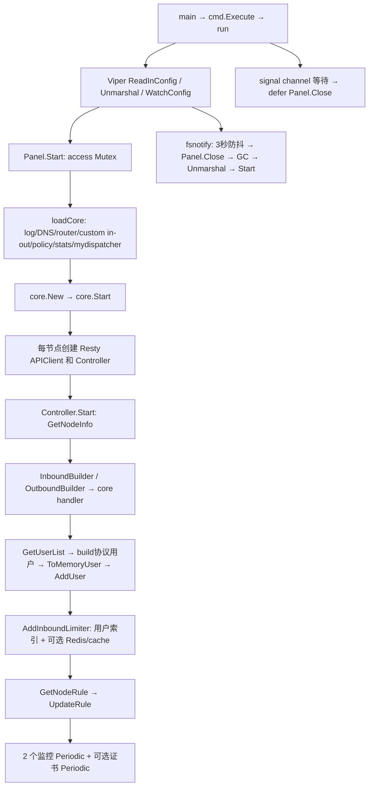
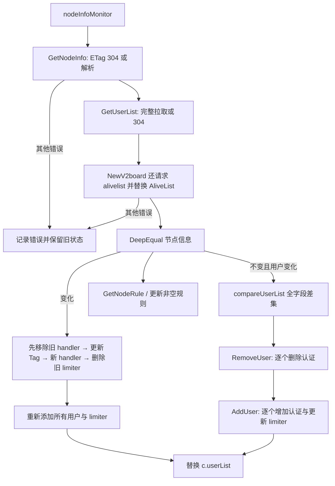
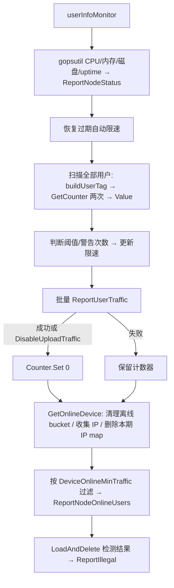
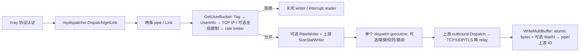

# XrayR 性能链路审计（修改前）

基准提交：`0bb4713626128849da0d2437defea1a1322c44cc`。代码证据均为本仓库和 go.mod 锁定的 Xray-core e80ca67feed9。优先级是候选调查顺序，不是生产 profile 排名。

## 范围与启动



节点默认周期 60 秒；证书周期为 UpdatePeriodic×60 秒。Controller.Start 注册两个监控任务后启动，初次监控因 startAt 检查跳过；证书任务无此延迟。Panel 只有一个共享 core，节点有独立 Controller/inbound/outbound/API/limiter 状态。配置加载及热更新显式 GC，不是数据面循环。没有注册独立 sing-box 或 Hysteria2；sing/sing-shadowsocks 用于 SS2022 key/method 辅助，不代表集成 sing-box core。支持的节点为 VMess/VLESS/Trojan/SS/SS-Plugin。

## 控制面与错误分支



节点变化路径不是事务：移除/添加失败可能留下部分状态。用户删除失败后仍可继续添加及保存列表；没有重试账本。本轮性能修改不得加重这些行为。已有 diff 是 O(N+M)，不是 O(N²)，但使用两张全字段 struct map、一个 O(M) 交集切片；重复的新用户如果旧列表不存在，出现两次以上会被原算法排除，等价测试需保留这一现有语义。返回顺序来自 map，本身无排序保证。



数据面不是每包请求 Panel。用户流量 counter 持有到 writer，读写时 atomic.Add，统计时有全表扫描、字符串构造和 stats.Manager 的 RLock。上报失败保留流量；在线信息和规则结果已先消费，报告失败没有同等保留机制。最大的正确性风险之一：上报期间新流量也会被 Set(0) 清掉，不能把减少读取次数等微优化误当修复。

## 数据面



每次 getLink 已有 O(1) 用户索引，不扫描所有用户。TCP 在线限制按 UID 对应面板 AliveList 判定，不能擅自改成本地 IP 数；未发现 XrayR 自己的实时连接数计数器或独立连接总数限制。UDP 不进入本地 TCP 在线 IP 分支，但可进入 Redis 全局限制及限速。

getLink 实际使用 `github.com/xtls/xray-core/app/dispatcher.SizeStatWriter`，本地 stats.go 同名 wrapper 不是这个链路调用的实现。Counter 是上游 atomic int64，GetCounter/RegisterCounter 则由全 core 的 RWMutex 保护。限速是同一用户上下行共享 token bucket；nodeSpeedLimit 在 determineRate 中只是每用户有效速率上限，不是独立全节点聚合 bucket。

嗅探 cachedReader 有每连接 Mutex 和缓存复制；最多两次、每次 read timeout 100ms，不是无限 busy loop。数据转发缓冲/加密/TLS/网络协议主要由上游实现；未改 io.Copy/splice。默认 BufferSize=64，由上游 policy 换算 KiB/pipe 限额，不等于一连接立即分配固定 64KiB；吞吐、pipe 积压、两方向及协议缓冲决定实际内存。getLink 设置 CanSpliceCopy=3，需要真实 Linux 协议流量检查 splice 是否实际走通。

## goroutine / timer 生命周期

| 来源 | 数量/触发 | 生命周期和风险 |
|---|---|---|
| cmd signal | 主 goroutine 1 个等待 | 退出时 Close；os.Kill 不能捕获 |
| Viper/fsnotify | 一个配置 watcher，内部 goroutine | 没有业务层重复每用户 watch |
| Controller go tasks.Start | 每节点 2 或 3 次启动 | 上游 Periodic 立即 Execute，再 AfterFunc；不是每节点永驻 ticker goroutine |
| Periodic AfterFunc | 每节点 2 或 3 个待触发 timer | 每轮完成后再 Interval，无单任务自重叠；不同任务可并发；Close 不等待正在执行的回调 |
| Dispatch / DispatchLink | 每次调用 1 个 goroutine | 包含嗅探和 routedDispatch；转发结束退出，非每用户常驻 |
| globalLimit → go pushIP | cache miss/新 IP 时每次一个 | 超时 context；没有有界队列，cache 故障/连接突发可形成 goroutine storm |
| go-cache janitor | 启用全局限制的每 inbound 1 个 | 每分钟清理；依赖库生命周期，不持有显式 Stop/Close 句柄 |
| Redis / Resty / core | 连接池、网络读写、协议任务 | 随实际连接和协议变化；DeleteInboundLimiter 和 dispatcher.Close 未显式关闭 Redis client |
| rule resultSet.Iterator | 每个结果汇总一次 goroutine/channel | 完整 drain 结束；不在每用户周期循环启动 |
| rate.WaitN | 需要等待速率 token 时 timer | 按 WriteMultiBuffer 调用；使用 Background，不受连接 context 取消；忽略 WaitN error 是已有风险 |
| certificate / OCSP | 每节点续期，TLS 配置 OCSP 3600 秒 | ACME/上游内部任务；非每用户 ticker |

本地生产源码无直接 time.NewTicker/NewTimer/After/Sleep 调用；隐式 timer 来源如表。没有 10000 用户对应 10000 常驻 goroutine 的本地实现证据。

## 共享数据和锁关系

| 结构 | 访问/锁 | 成本/生命周期 |
|---|---|---|
| Panel.access | Start/Close 全程 Mutex | 冷路径，包含 core/节点启动，不是 per packet 大锁 |
| Controller nodeInfo/Tag/userList | nodeInfoMonitor 写、userInfoMonitor 读 | 未同步；同时更新与上报存在 race 风险 |
| InboundInfo map | sync.Map: Tag → 指针 | 节点增删；未对 Redis 提供 close |
| UserInfo | sync.Map: composite Email → 24B UserInfo value（64bit） | O(users)，删除认证时没有 Delete 用户索引，churn 可增长 |
| BucketHub | sync.Map: Email → rate.Limiter | 每活跃限速用户一份；rate.Limiter 内部 Mutex，上下行共享 |
| UserOnlineIP | sync.Map: Email → sync.Map IP→UID | 每周期清除；当前每 TCP 调用都先分配一个候选 map，即使已有 |
| OldUserOnline | sync.Map IP→UID | 收集后仅匹配旧 IP 时删，历史 IP 未设置 TTL，可能增长 |
| AliveList | map[int]int | controller 替换 map 指针而连接读取，没有同步 |
| stats.Manager | 全 core RWMutex 保护 map | 连接创建和周期查询锁；每包只 atomic Counter |
| RuleManager | sync.Map + threadSafeSet 的 RWMutex | 每规则线性匹配；每命中先构造候选 set；报告通过 LoadAndDelete 分离 |
| SSPanel/BunPanel access | Mutex 保护 LastReportOnline | ReportNodeOnlineUsers 锁跨 HTTP；ParseUserList 等待同锁，慢 Panel 会拖慢同步 |
| V2RaySocks access | Mutex 保护节点 response/规则 | 规则编译期间持锁；非每包 |
| NewV2board/goV2Panel response | atomic.Value | 节点快照读取；ETag map 由节点监控串行使用 |

```text
连接: sync.Map 查找 → IP sync.Map → 可选 cache/Redis → bucket sync.Map
转发: Counter atomic → rate.Limiter Mutex/等待 → 上游 pipe/IO
同步: Panel API → 用户 diff → core 用户管理锁 / limiter.Store
统计: stats.Manager RLock（逐次释放）→ HTTP → Counter.Set
SSPanel: access.Lock → HTTP → access.Unlock；用户解析竞争相同锁
```

没有充分生产数据判定“最大锁竞争”；不能简单用 sharding/atomic 替换以上结构。在线 Range/Delete 与新连接写并发存在已有周期边界竞争，Load 快路径需保持原 miss 的 LoadOrStore 语义。

## API、日志、构建

七个 adapter 使用复用的 Resty client，默认 5 秒 timeout、配置 retry=3。SSPanel/BunPanel 使用 envelope+RawMessage typed 解码；PMPanel/ProxyPanel 类似分层 typed 解码。NewV2board/GoV2Panel 存在 simplejson 解析 → Encode → typed Unmarshal，V2RaySocks 有 generic JSON/string 转换；该开销随用户数放大，但直接替换必须验证数值、字段大小写、null、无效响应、ETag 错误语义。SSPanel/部分 adapter 有 ETag；PMPanel/ProxyPanel 不应假设有 304 缓存。NewV2board 即使 users 304 仍调用 alivelist。

规则在同步时编译，不在每连接 regexp.Compile；Detect 每规则 `[]byte(destination)` 是待测 allocation。拒绝路径有 fmt.Sprintf，rule 无效 UID 的 Debug 即使关闭仍先格式化；logrus、标准 log 和 Xray logger 并存，配置 core Level 不等于关闭所有 controller log。不要通过关闭必要日志改变功能。

Docker Go=1.23.1、CGO=0、trimpath、ldflags -s -w -buildid=；release workflow Go ^1.21 与 go.mod 1.23.1 不一致，自动 toolchain 行为需 CI 验证。没有本地 core 选择 build tags；all.go blank-import 注册所有支持的协议/传输，lego dns registry 引入大量 provider。删除依赖会删功能，本轮不做。已注册 metrics 包不代表 loadCore 实际启用 metrics feature，本地无 pprof HTTP endpoint。编译体积不是 RSS。

## 候选优先级

1. P0 稳定性门槛：统计清零、共享快照、回调退出、Redis lifecycle、历史 map 增长。需要独立故障/并发实验和行为规格，不用性能优化掩盖。
2. P1 每连接 limiter 候选对象无条件分配；按命中 Load、miss LoadOrStore 保持并发初始化，先测首连接/重连/并行。
3. P2 每规则 string→[]byte、每命中临时 set；先测 MatchString/命中复用。
4. P3 diff 两张 map+交集改成一张状态索引；O(N) 不变，测 100/1000/10000/50000 和 churn。
5. 后续 typed JSON、stats 字符串构造、HTTP 锁范围；先采真实比例。
6. P4 relay/syscall、P5 runtime/build 参数不凭本机微基准调整。
